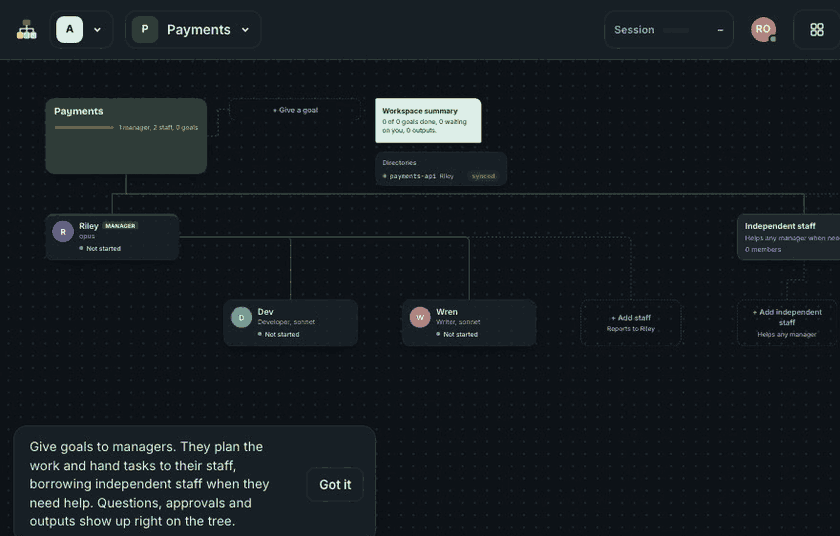

<p align="center">
  <picture>
    <source media="(prefers-color-scheme: dark)" srcset="docs/assets/logo-dark.svg">
    
  </picture>
</p>

<h1 align="center">Canopy</h1>

<p align="center">
  <a href="https://github.com/ayyshim/canopy/actions/workflows/ci.yml"></a>
  <a href="https://github.com/ayyshim/canopy/releases"></a>
  
  
</p>

<p align="center">
  
  
  
  
  
  
</p>

Canopy runs teams of coding agents (Claude Code today) on your own computers and shows each
workspace as a live tree: people, their workspaces, and the manager and staff agents working on
their goals. Anything that needs a person, such as a question, an approval, access to a folder or
a review, waits on the tree until someone answers.

<p align="center">
  
</p>

It comes as two programs:

| Program | Runs on | What it does |
|---|---|---|
| `canopy-hub` | one server, or your own computer to try it | The web app, the API, live boards, email, and its own PostgreSQL. One file. |
| `canopy` | every computer that runs agents | Pairs with the hub, runs Claude Code in a sandbox, works in git branches, syncs folders. |

## What you need

- **Linux** on the computers that run agents. The hub also runs on macOS, but the macOS client
  can’t sandbox agents yet (see [Known gaps](#known-gaps)).
- **Claude Code**, installed and signed in (`claude`, then `/login`), or an Anthropic API key.
- **bubblewrap**, the sandbox agents run in: `sudo apt install bubblewrap`,
  `sudo pacman -S bubblewrap` or `sudo dnf install bubblewrap`.
- **git**. Add the GitHub CLI (`gh`, signed in with `gh auth login`) if you want Canopy to open
  pull requests for you.

## Install

The installer picks the build for your system, checks it against the release’s `SHA256SUMS`,
and puts it in a folder on your `PATH`, so you can run it from any folder.

```sh
# the hub
curl -fsSL https://github.com/ayyshim/canopy/releases/latest/download/install.sh | sh -s -- hub

# the client
curl -fsSL https://github.com/ayyshim/canopy/releases/latest/download/install.sh | sh
```

Open a new terminal afterwards if the installer says it added a folder to your `PATH`.

- **A particular version:** add `--version v0.1.0` after `--`.
- **macOS, v0.4.2 or earlier:** if the installer stops with `REPO?: unbound variable`, run it
  with `LC_ALL=C sh` in place of `sh`.
- **A binary you downloaded yourself:** let it install itself.

  ```sh
  chmod +x canopy-linux-amd64
  ./canopy-linux-amd64 install        # installs as canopy
  ```

  It goes to `~/.local/bin`, or `/usr/local/bin` when run with `sudo`. Pick another folder with
  `--dir`. On macOS, clear the browser’s quarantine flag first:
  `xattr -d com.apple.quarantine canopy-darwin-arm64`.

To upgrade later: `canopy-hub update` on the hub, then `canopy update` on each computer.

## Set up

These steps run everything on one computer. [Run it for a team](#run-it-for-a-team) covers a server.

1. **Start the hub.**

   ```sh
   canopy-hub
   ```

   It starts in the background, keeps its data in `~/.local/share/canopy-hub`, and prints
   where to open it and a setup link:

   ```
   The hub is running (pid 4182).
     Open:   http://localhost:8080
     Set up: http://localhost:8080/hub-setup?token=...
   ```

2. **Create the hub admin.** Open the setup link, name the hub, and create your account.
3. **Create an organization.** Press **Create an organization** at the top of the admin page.
4. **Connect your computer.** Open **Set up a workspace** (or **Organization → Computers → Get
   install command**). Canopy shows a one-time code. In another terminal, run the command it
   shows, which looks like:

   ```sh
   curl -fsSL http://localhost:8080/install.sh | sh -s -- --code ABCD-EFGH
   ```

   On macOS with a hub at v0.4.2 or earlier, if it stops with `HUB?: unbound variable`, run
   it with `LC_ALL=C sh` in place of `sh`.

   That installs `canopy`, pairs it with the hub, and keeps it running as a user service. If
   `canopy` is already installed, you can do the same by hand:

   ```sh
   canopy pair --hub http://localhost:8080 --code ABCD-EFGH
   canopy run
   ```

   The setup page turns green when the hub can reach your computer.
5. **Create a workspace.** Name it, pick the repositories and folders agents may use, choose how
   Claude Code signs in, review the agent members, and press **Create workspace**.
6. **Give a goal.** Give the manager a goal and watch the tree. Answer questions and approvals
   where they appear.

`canopy-hub status` shows the address and setup link again, `canopy-hub stop` stops the hub,
and `canopy-hub` starts it again. Your data stays in `~/.local/share/canopy-hub`.

## Run it for a team

People open the hub in a browser. Their computers connect to it on a second port (8443) with
mutual TLS, so open that port too. With a DNS name pointing at the server, install the hub as
a service that starts at every boot (Linux with systemd):

```sh
sudo SMTP_ADDR=smtp.example.com:587 SMTP_FROM="Canopy <canopy@example.com>" \
  canopy-hub --as-srv --domain canopy.example.com
```

The hub gets HTTPS certificates from Let’s Encrypt by itself and sends invites and
notifications through your SMTP server. It runs as the user `canopy` with its data in
`/var/lib/canopy`, and prints the setup link when it starts. Manage it with
`sudo canopy-hub status`, `sudo canopy-hub stop`, `sudo canopy-hub` (start) and
`sudo canopy-hub remove-srv`. Each person then connects their own computer from
**Organization → Computers → Get install command**. Admins can also share one server for
people who don’t have their own computer.

[docs/RUNNING.md](docs/RUNNING.md) covers running behind Caddy or nginx, the boot service in
detail, upgrades and backups, and plain http on a home network.

## Everyday commands

| Command | What it does |
|---|---|
| `canopy-hub` | Start the hub in the background (log: `~/.local/share/canopy-hub/hub.log`) |
| `canopy-hub status` | Show whether it’s running, its address, and the setup link |
| `canopy-hub stop` | Stop it |
| `canopy-hub --foreground` | Run it in this terminal instead |
| `sudo canopy-hub --as-srv` | Install it as a service that starts at boot (Linux) |
| `sudo canopy-hub remove-srv` | Remove that service; the data stays |
| `canopy-hub update` | Install the latest release and restart the hub (`sudo` for the service) |
| `canopy-hub backup` | Copy the database (stop the hub first) |
| `canopy-hub migrate status` | Show what an upgrade would change |
| `canopy pair --hub URL --code CODE` | Pair this computer with a hub |
| `canopy run` | Start running agents in the background (log: `~/.local/share/canopy/canopy.log`) |
| `canopy stop` | Stop it |
| `canopy update` | Install the client build your hub serves and restart it |
| `canopy status` | Show whether it’s running, its pairings, and installed CLIs |

When the installer set up the user service, manage it with `systemctl --user status canopy`
and `journalctl --user -u canopy -f`. Every command, flag and setting is in the
[command reference](docs/RUNNING.md#command-reference).

## Known gaps

- **macOS computers can’t sandbox agents yet**, so the client refuses to run them there.
  `canopy run --unsafe-no-sandbox` works, but agents can then read everything your user can. Use
  a Linux computer, a VM, or a shared Linux server for real work.
- **Claude Code only.** Codex, Gemini and Pi are detected but don’t run yet.

## Development

The hub and client are Go (`hub/`, `client/`, `shared/`), and the web app is Next.js
(`frontend/`). You need Go, Node with pnpm, and Docker.

```sh
make infra     # Postgres, Redis, S3 storage, Mailpit and Caddy in Docker
make hub       # the API on :8080; prints a setup link on first start
make web       # the web app; open http://localhost:8000
make test      # Go tests
make system    # hub, client and a fake Claude as real processes
make release   # both binaries for Linux and macOS, in dist/
```

Every push and pull request runs the Go tests, the system tests and the web app checks
(`.github/workflows/ci.yml`). Pushing a tag such as `v0.1.0` builds and publishes a GitHub release with every binary and the
installer.

- [docs/SPEC.md](docs/SPEC.md): what Canopy does.
- [docs/DECISIONS.md](docs/DECISIONS.md): where this build differs from the spec.
- [docs/RUNNING.md](docs/RUNNING.md): running, every command, and settings.
