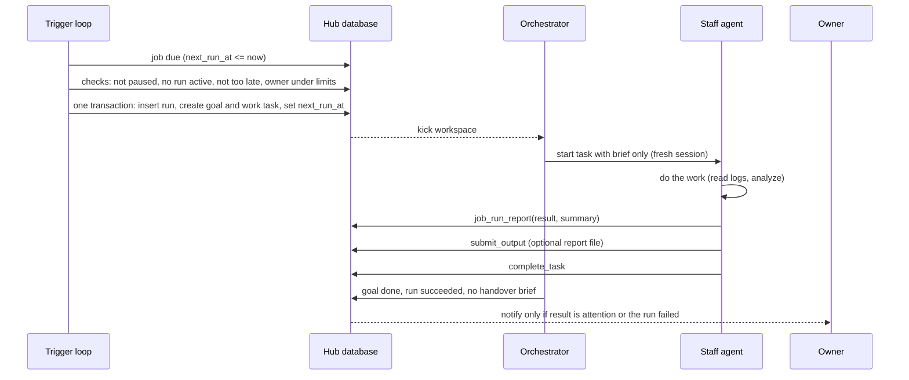
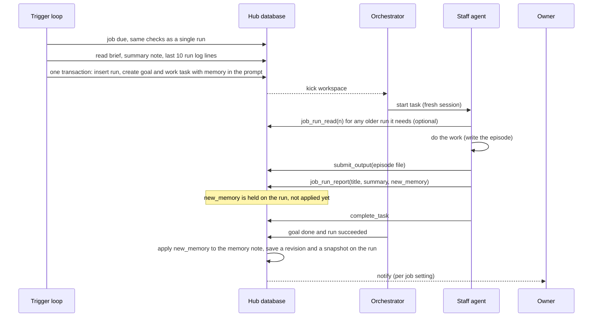

# Job scheduler: plan

G-29 · T-173. Builds on `job-scheduler-findings.md` (how Canopy runs work today) and
`job-scheduler-research.md` (how other schedulers and agent memory work). Paths are
under `hub/internal/` unless noted. This is a plan, not code.

## 1. What we are building

People want Canopy to do work on a clock, without someone giving a goal each time.
Two kinds of work:

- **Single run.** "Check today's logs and report anything odd." Every run starts clean. No memory.
- **Continuous run.** "Write a new episode on this theme every day at 9." Each run must know what the earlier runs did.

Short answer for the design:

- A **job** is a saved instruction with a schedule and an owner.
- Each time it is due, the hub makes a **run**. A run is a normal **goal** that Canopy already knows how to plan, work, show on the board and bill.
- The only difference between the two types is **what goes into the run's prompt** and **whether the run may write memory**.
- Memory is a **note** (so it has revisions, shows up in the UI and can be edited by people) plus a **run log** built from the run rows.

Nothing in the agent runtime changes. The new parts are a timer loop, two tables (`jobs`, `job_runs`) plus two columns, a few
changes to goal finishing, three agent tools in the MVP and a Jobs page.

## 2. Core ideas

| Term | Meaning |
| --- | --- |
| Job | A saved instruction: what to do, who does it, when, and the rules for it. Belongs to a workspace and has one owner (a person). |
| Schedule | A 5-field cron expression plus an IANA time zone. Stored as cron, never as text. The next time is stored in UTC (`next_run_at`). |
| Run | One execution of a job. One row in `job_runs`, with a status and a link to its goal. Skipped and failed runs are rows too. |
| Single run job | No memory. The prompt has the brief only. |
| Continuous job | Has memory. The prompt has the brief, a rolling summary and the latest run log lines. The run may update the summary. |
| Brief | Text written by people: the task, theme, rules, format. Agents never change it. |
| Memory | The rolling summary (agent writes it, people can edit it) and the run log (the hub writes it). |
| Owner | The person the run is attributed to. Their computer runs it, their limits apply (DECISIONS: Attribution, Where work runs). |

## 3. One run, end to end

### Single run



### Continuous run



If the run fails before the last step, `new_memory` is thrown away and the memory is exactly as it was.

## 4. Data model

Three changes. All are new goose migrations; no applied migration is edited.

```sql
-- the job
jobs (
  id, workspace_id, title,
  kind                 text,  -- 'single' | 'continuous'
  status               text,  -- 'active' | 'paused' | 'ended'
  pause_reason         text,  -- '', 'owner', 'failures', 'cap', 'owner_left'
  brief                text,  -- written by people
  owner_user_id        uuid,
  manager_id           uuid,  -- visible to; plans if plan_each_run
  assignee_member_id   uuid,  -- who does the work; null = the manager plans each run
  runner_id            uuid,  -- null = owner's own computer, else a shared one
  cron                 text,
  timezone             text,  -- IANA, default: the organization's time zone
  next_run_at          timestamptz,
  last_run_at          timestamptz,
  missed_policy        text,  -- 'skip' | 'run_once'
  catchup_window_secs  int,   -- how late a run may still start
  run_timeout_secs     int,   -- default 7200
  token_cap_per_run    bigint,   -- null = none
  token_cap_per_month  bigint,   -- null = none
  notify               text,  -- 'attention' | 'always' | 'failures'
  ends_at              timestamptz, max_runs int,
  required_dirs        jsonb, -- same shape as tasks.required_dirs
  memory_note_id       uuid,  -- continuous only: the summary note
  consecutive_failures int,
  created_by, created_at, updated_at
)

-- one row per run, including skipped ones
job_runs (
  id, job_id, number int,         -- number per job: run 1, 2, 3
  scheduled_for timestamptz,      -- the time it was due
  trigger text,                   -- 'schedule' | 'manual' | 'test'
  status  text,                   -- 'running' | 'succeeded' | 'failed' | 'skipped' | 'capped' | 'cancelled'
  skip_reason text,               -- 'previous run still going', 'too late', 'owner over limit', 'computer off', ...
  attempt int,                    -- 1, later 2 and 3 for retries
  goal_id uuid,                   -- the goal of the current attempt
  started_at, finished_at,
  tokens bigint,                  -- sum of usage events of the goal's tasks
  result text,                    -- 'ok' | 'attention' | 'nothing_to_do'
  title text, summary text,       -- what the agent reported: this is the run log line
  error text,
  pending_memory text,            -- held until the run succeeds
  memory_after text               -- snapshot of the summary after this run
)
-- unique (job_id, scheduled_for) where trigger = 'schedule'   (a due time can only start once)
-- unique (job_id) where status = 'running'                    (the database itself forbids overlap)

-- link a goal back to its run
goals.job_run_id uuid null references job_runs on delete set null
```

Notes:

- **Memory note.** A continuous job owns one note, kind `job_memory`, with the job's id on it (add `notes.job_id`, and widen the `notes.kind` check from migration 00009, which today allows only `note`, `plan`, `decision`, `summary`). That gives revisions (`note_revisions`, last 20), the editor trail, the `N-` ID, and `read_notes`/`read_item` for free. `memory_after` on each run keeps the full history even after 20 revisions.
- **Outputs need no new table.** Run → goal → tasks → outputs already links a run to its files. (The findings doc said a link table was needed; it is not, because `job_runs.goal_id` gives the path.)
- **Retries** reuse the same run row. Each attempt is a new goal, so several goals can point to one run. `goals.job_run_id` is many-to-one.
- **Attachments** for a job (reference files): add `job_id` to `attachments` so the CHECK becomes "exactly one of goal, task, job", and let `taskAttachments` (`orch/attachments.go`) include the job's. Phase 2.
- **Item numbers.** Add a `J-` number later so people can write `J-3` in notes. Phase 2.

## 5. The trigger engine

A new flat package `hub/internal/jobs`. `Engine.Run(ctx)` starts from `cmd/hub/main.go` beside the other loops. It ticks every 15 seconds. The tick is cheap: one indexed query for due jobs.

```
due = jobs where status='active' and next_run_at <= now      -- FOR UPDATE SKIP LOCKED
for each job, in one transaction:
  1. past ends_at or max_runs?   -> status 'ended', stop
  2. too late (now - next_run_at > catchup window)?
        -> skipped run 'too late' (or run once, see missed runs)
  3. a run is still going?       -> skipped run 'previous run still going'
  4. owner removed or computer unusable for good? -> pause the job (reason owner_left)
  5. owner over session or weekly limit?        -> skipped run 'owner over limit'
  6. otherwise: create the run and its goal (section 6)
  always: next_run_at = next cron time strictly after now   (never after the old time)
```

Rules, each from the research doc:

- **Cron plus zone.** Parse 5-field cron (add one small dependency such as `robfig/cron/v3`'s parser, or write about 80 lines; the stdlib has none). Compute next time in the job's zone, store UTC. The default is `organizations.timezone`, which already exists. Users have no time zone of their own (the notifier reads the organization's), so the create dialog must let the person pick a zone, and a per-user zone is a later option.
- **Daylight saving.** A time that does not exist (spring forward) runs at the next valid moment. A time that happens twice (fall back) runs once. The library's default may skip the missing time, so the wrapper needs tests for both cases and for a zone like `Asia/Kathmandu` (+05:45).
- **Missed runs.** After a hub outage, the first tick finds `next_run_at` in the past. If the miss is inside the window, `run_once` starts one run now. Otherwise it records `skipped: too late`. Never replay a pile. Defaults: single run `skip` with a 1 hour window; continuous `run_once` with a 6 hour window.
- **No overlap.** Step 3 plus the partial unique index. If two hubs ever ran, the index stops a second run.
- **Idempotent.** The unique `(job_id, scheduled_for)` key means a crash and restart cannot start the same due time twice.
- **Pause and resume.** `status='paused'` with a reason and who paused it. Resume recomputes `next_run_at` from now. Nothing missed while paused is replayed.
- **Run now.** Creates a run with trigger `manual`. It does not move `next_run_at`. It still obeys no-overlap.
- **Test run.** Trigger `test`. Same prompt, but it never writes memory and does not count as a failure. Use it to try a new brief.
- **Retries (phase 2).** A failed attempt is retried up to 2 times after 1 and 5 minutes, as the same run. A retry is a new goal, and memory is written only when an attempt succeeds.
- **Run timeout.** The tick also checks running runs. Past `run_timeout_secs` the run is stopped: sessions ended, status `failed` (or `skipped: computer off` if no task ever started).

## 6. How a due run becomes a goal

The trigger calls `core.CreateGoal` (`core/goals.go`) with `By` = the owner. That is the same path a person uses, so placing the goal on a computer, usage metering, notifications and the board all work unchanged.

Two modes, chosen when the job is created:

| Mode | When | What happens |
| --- | --- | --- |
| **Direct** (default) | The job names an assignee: a staff member or the manager | The goal is created `active`, with one work task for the assignee, created right away. No plan task, so no manager session is spent per run. `placeGoals` already handles `active` goals. |
| **Planned** | `plan_each_run` is on, assignee empty | The goal is created `planning` as today. The manager plans and splits the work. Use for big jobs. |

The run's task text (`tasks.description`, printed by `taskPrompt`) is built by `jobs` at creation:

- **Single:** the brief, plus a fixed footer (section 7).
- **Continuous:** the brief, the summary, the newest 10 run log lines, and a footer.

What changes in existing code:

| File | Change |
| --- | --- |
| `orch/goals.go` `finishGoals` | A goal with `job_run_id` skips the handover task. It saves the run's summary and closes the goal (`closeGoal`), then calls `jobs.RunFinished`. Today the handover brief always waits for a person, even with `goal_completion=auto`, so without this change every run would stall. |
| `orch/goals.go` `goalTasksDone` | For job goals, do not open the "goal ready" card; the run record replaces it. |
| `orch/tools.go` | New tools (section 8). `complete_task` stays as is. |
| `orch/prompts.go` `systemPrompt` | List the job tools only for sessions working on a job goal. |
| `api/limits.go` | `personUsage` is a method on `api.Server`, so `jobs` cannot call it without importing `api`. Move the limit math (`personUsage`, `WeekStart`) into `core` or a small `limits` package and use it from both. Do not queue job runs; a late run is skipped, not delayed. |
| `core/goals.go` | `CreateGoal` always creates a `planning` goal today. `NewGoal` gets `JobRunID` and a `Direct` flag so the goal starts `active` with its work task. |
| `cmd/hub/main.go` | Start `jobs.Engine`. |
| `notify/notify.go` | One new kind `jobs` (section 10). `KindOf` maps signal types to the kinds, so add job signal types (for example `job_attention`, `job_failed`) and map them to `jobs`. |

Who works the run: the goal's owner computer, signed in with the owner's account (`placeGoals`, DECISIONS "Where work runs"). If the owner's computer is off, the goal waits and the run times out as `skipped: computer off`. A job can be set to a shared computer (API-key, with a daily cap) so it runs when laptops are off. Only the owner or an admin can choose a shared computer, as for goals.

Directories: the job stores `required_dirs`. At creation the job form checks that the assignee already has grants for them. At run time a missing grant still raises the normal directory request, which times out as Deny after 30 minutes (`GateTimeout`).

## 7. The run prompt

The same footer goes on every job run (the brief cannot override it):

> This is an automated run. Nobody is watching. Do not ask questions; decide and write down your assumptions. If you cannot finish, say what is missing in your summary and call complete_task. When you are done, call job_run_report.

Layout of the task text, in this order (stable parts first so the CLI prompt cache helps):

1. `Job: <title> (run N, scheduled for <local time and zone>)`
2. `Brief:` the brief
3. Continuous only: `Memory (rolling summary):` the summary
4. Continuous only: `Earlier runs:` newest 10 lines: `#41 Jun 3 · "The lighthouse keeper" · ok`
5. The footer

Single-run jobs never get 3 or 4, and they do not get the memory tools, so an agent cannot accidentally depend on a past run.

## 8. Memory for continuous jobs

**Three layers**, as the research recommends:

| Layer | Owner | Where | In every prompt? |
| --- | --- | --- | --- |
| Brief | People | `jobs.brief` | Yes |
| Rolling summary | Agent writes, people can edit | The memory note | Yes |
| Run log | Hub | `job_runs` (title, result, summary, number, date) | Newest 10 lines |

**Writing memory.** The agent calls `job_run_report(title, summary, result, new_memory)` near the end. The hub stores `new_memory` in `pending_memory`. When the goal completes and the run is marked `succeeded`, the hub applies it in one transaction: save a revision of the note, update the note, copy the text to `memory_after`. A failed, capped or cancelled run drops `pending_memory`. Memory is therefore always the result of a whole successful run.

**Size budget.** The memory part of a prompt is about 4k tokens: summary at most about 800 words (hard cap 5,000 characters), plus 10 run log lines. The hard cap is enforced when the agent reports: a longer `new_memory` is refused with "Too long. Fold the oldest details into short facts, keep names and open threads, and send it again." So compaction is done by the agent that knows the story, at write time, and it needs no extra job. The previous text is never lost (revision plus `memory_after`).

**References.** Past outputs are not put in the prompt. `job_run_read(n)` returns run n's title, summary, result, memory snapshot and its output names. A second argument asks the hub to put that run's output files in the agent's `./attachments` (reusing the stored blob; confirm how `toolAttachFile` stores blobs before building). That is retrieval without embeddings. Text in the brief such as `N-70` or `G-12` is already expanded by the "Referenced items" block (`orch/items.go`), so people can point a job at existing notes. Job attachments come in phase 2.

**Viewing and editing** (Memory tab, section 11):

- Brief: editable any time; takes effect on the next run.
- Summary: editable by the owner and workspace admins, with revisions and a restore button. **Editing is disabled while a run is going**, otherwise the run would overwrite the edit when it finishes.
- "Reset memory" clears the summary (the old text stays as a revision).
- Run log: read-only, each line opens the run (goal, outputs, tokens).

## 9. Agent tools

Added to the Canopy MCP server (tool list in `shared/protocol/protocol.go`, handlers in `orch/tools.go`, same pattern as `read_notes`).

| Tool | Who | Does |
| --- | --- | --- |
| `job_run_report(title, summary, result, new_memory)` | Session on a job goal | Records the run line. `result`: `ok`, `attention` (something a person should look at), `nothing_to_do`. `new_memory` is allowed only for continuous jobs. |
| `job_memory_read()` | Continuous run | The brief, summary and full run log (the prompt only has the newest 10). |
| `job_run_read(n, files)` | Continuous run | One earlier run, optionally with its output files. |
| `list_jobs()` | Manager | Jobs for the manager, with status and next run. Read-only. |
| `propose_job(...)` | Manager (phase 3) | Drafts a job for a person to approve, like `propose_staff`. Agents never create live jobs on their own. |

A run that finishes with no `job_run_report` is marked `failed: no report`. An agent that calls `complete_task` first is told to report first.

## 10. Notifications, permissions, caps, failures

**Notifications** use the existing outbox (`notify.Enqueue`) and the Discord and push channels. One new kind `jobs`, with a per-job setting:

- `attention` (default): notify when a run reports `attention`, fails, or the job auto-pauses.
- `always`: also on every success (good for the daily episode, with a link to the output).
- `failures`: only failures and auto-pause.

A `nothing_to_do` or `ok` single run is silent, so a daily check that finds nothing does not spam anyone.

**Permissions** (all through `hub/internal/authz`; 404 for what the caller cannot see):

- Create: any person who could give a goal to that manager (workspace admin, or staff who can see the manager's team).
- See: anyone who can see the manager (the same rule as goals).
- Edit, pause, resume, run now, delete: the owner and workspace admins.
- The owner's own limits apply to every run. An owner who is removed from the workspace pauses their jobs (`owner_left`); an admin can reassign the owner.
- Shared computer: as for goals.

**Cost caps.** Canopy counts tokens, not money (subscription accounts have no price). Caps are in tokens:

- `token_cap_per_run`: the tick sums the tokens of the run's goal (`usage_events.goal_id` and the `usage_work` totals, migration 00022). Over the cap, the run is stopped and marked `capped`.
- `token_cap_per_month` (phase 2): the sum of `job_runs.tokens` for the month. Over the cap, the job pauses with reason `cap`.
- Org and personal limits still apply on top.

**Failure handling**

| What goes wrong | What happens |
| --- | --- |
| Hub down at the due time | First tick after restart: run once if inside the window, else `skipped: too late`. |
| Owner's computer is off | Goal waits. If no task starts before the timeout, run is `skipped: computer off`. Does not count as a failure. |
| Hub restarts while a run is going | The run row and its goal are in the database, so the run continues. The tick still applies the run timeout. |
| Agent crashes | Existing recovery restarts the session. Counts only if the run ends failed. |
| Run fails halfway | Run `failed`, memory unchanged, outputs of the attempt stay visible. Counts toward auto-pause. |
| Agent asks a question anyway | The question shows on the board as usual. No one answers, so the run times out and fails. The footer makes this rare. |
| Next run due while this one runs | Next run recorded as skipped. |
| Subscription limit reached | Existing usage-limit signal. If the reset is after the timeout, the run is `skipped: usage limit`. Does not count as a failure. |
| 3 failed runs in a row | Job auto-pauses (`failures`) and notifies the owner. Resume is manual. `skipped` and `capped` runs do not count. |
| Report missing or memory too long | `failed: no report`, or the agent is told to shorten and try again. |

## 11. UI

Plain words in the UI: "Job", "Run", "Memory". No "signal", no "cron" on the main path.

- **Top bar:** a Jobs button next to Outputs, opening `/w/:id/jobs`. New components go in `frontend/src/components`, the page in `frontend/src/app/(app)/w/[id]/jobs/`.
- **Jobs list:** title, type chip (Single or Continuous), schedule in words ("Every weekday at 9:00, Kathmandu time"), next run, last result, status. Row actions: Run now, Pause or Resume.
- **Create a job** (one dialog, four steps):
  1. What: title, type, brief. For Continuous, a short hint text: "Describe the theme and rules. Canopy remembers what each run did."
  2. Who: manager, assignee ("Do the work directly" or "Let the manager plan each run"), computer.
  3. When: a picker (Every day, Weekdays, Weekly, Monthly, plus time and zone) and a text box ("every weekday at 9"). Both fill the same fields. **It always shows the next 5 run times and a plain sentence**, and the person confirms. An "Advanced" field takes a raw cron expression.
  4. Rules: missed runs, notify setting, caps, end date. Defaults are filled in.
- **Job page** with tabs:
  - **Runs:** table of every run (number, due time, status chip, result, tokens, duration). Skipped runs show their reason. A row opens the run's goal and outputs.
  - **Memory** (Continuous only): brief, summary with revisions, run log.
  - **Settings:** everything from the dialog, plus Delete.
- **Board:** a run is a normal goal card with a small "Job" tag that opens the job. Finished job goals hide their tasks already (`show_tasks=false`). Phase 2: a board filter to hide finished job goals so a daily job does not fill the board.

REST, under `/api/v1`: `GET/POST /workspaces/:id/jobs`, `GET/PATCH/DELETE /jobs/:id`, `POST /jobs/:id/pause`, `/resume`, `/run` (body: `test: bool`), `GET /jobs/:id/runs`, `GET/PUT /jobs/:id/memory`, `POST /schedules/preview` (cron or text, zone → cron, sentence, next 5 times). Realtime: `job.updated`, `job.run.updated`. Types go in `shared/openapi.yaml`.

## 12. The "smart" parts

| Feature | Phase | Note |
| --- | --- | --- |
| Schedule from plain text with a preview | 1 | **Done by a small grammar in the hub, not a model** (see open question 1). Covers "every day at 9", "weekdays at 9:30", "every Monday at 8", "first of the month". |
| Next-5-times preview and plain sentence | 1 | Stops wrong schedules and time zone mistakes. |
| Auto-pause after 3 failures | 1 | |
| Per-run token cap | 1 | |
| Test run that never writes memory | 1 | |
| Silent when nothing to report | 1 | `result` + notify setting. |
| Retries with backoff | 2 | |
| Monthly cap, end date, max runs | 2 (end date and max runs are cheap, may land in 1) | |
| Skip if nothing changed | 2 | First version: the agent's first step is a quick check and it reports `nothing_to_do`. A true zero-token check needs a command on the runner (phase 3). |
| Alert if a run never started (dead-man) | 2 | Based on `next_run_at` plus a grace time. |
| Model-based schedule text, job drafts from chat | 3 | |
| Overlap "buffer one" | 3 | |

## 13. Phased rollout

**Phase 1: MVP (both job types, direct mode)**

1. Migrations: `jobs`, `job_runs`, `goals.job_run_id`, `notes.job_id` and kind `job_memory`. sqlc queries.
2. `jobs` package: cron parse with zone and DST tests, next-time function, the tick, run creation, no-overlap, missed-run policy, pause, resume, run now, test run, timeout, auto-pause, per-run cap.
3. Goal finishing for job goals (skip handover) and `RunFinished`.
4. Tools: `job_run_report`, `job_memory_read`, `job_run_read` (without files).
5. REST, authz, realtime events.
6. UI: list, create dialog with picker and grammar text box and preview, job page with Runs and Memory tabs.
7. Notifications (kind `jobs`).
8. Tests: tick logic with a fake clock (due, late, overlap, DST, restart in the middle of a run), memory applied only on success, handover skipped, authz.

Exit check: a single run job and a continuous job each run three times on a fake clock, and an end-to-end test shows run 3 prompt contains runs 1 and 2.

**Phase 2: Safe to leave alone**

Retries, monthly cap, end date, max runs, attachments on jobs, run output files in `job_run_read`, `J-` refs, skip-if-unchanged (agent check), dead-man alert, board filter, planned mode polish.

**Phase 3: Smarter**

Agents propose jobs, model-based schedule text, zero-token pre-check on the runner, overlap buffer, job templates.

## 14. Open questions, with a recommended answer

1. **Natural language schedule: how, when the hub does not call models?** The hub does not proxy model traffic (SPEC non-goals). *Recommend:* a picker plus a small grammar in the hub for MVP; ask a manager agent in phase 3. The research doc suggested a model; this is the safer variant.
2. **Goal per run or a lighter task?** *Recommend:* goal per run. It reuses everything. "Direct" mode removes the plan cost.
3. **Skip the handover brief for job runs?** *Recommend:* yes. The run summary is the record. Keep an option later to require review on jobs that publish something outward.
4. **Where does memory live?** *Recommend:* one note per continuous job, plus snapshots on runs. Not a new table.
5. **Which time zone by default?** *Recommend:* the organization's (`organizations.timezone`), changeable per job in the dialog, always shown on screen. There is no per-user time zone today.
6. **Who owns a job when the owner leaves?** *Recommend:* auto-pause with `owner_left`; an admin picks a new owner.
7. **Can people edit memory during a run?** *Recommend:* no (disabled with a short reason).
8. **Cancelled run: which goal status?** Today a goal is `planning`, `active`, `ready` or `done`. *Recommend:* add `stopped` so a cancelled or capped run does not look like a finished goal. Check goal status constraints and board code first.
9. **Do jobs get their own concurrency limit on a computer?** *Recommend:* yes, a small one (for example 2 job runs at once per computer) so ten jobs due at 9:00 do not start ten sessions at once; extra runs wait inside their window.
10. **Run history retention?** *Recommend:* keep rows forever; they are small. Keep `memory_after` for 90 days, then drop all but every 10th.
11. **Cap units?** *Recommend:* tokens only; show the number in the UI. Revisit when API-key accounts report cost.

## 15. Risks

| Risk | Why it matters | Reduction |
| --- | --- | --- |
| Runaway cost | A bad job runs every day | Per-run cap, auto-pause, owner limits, limit on concurrent runs |
| Memory drifts or gets poisoned | An agent writes a wrong fact and every later run builds on it; text from logs can contain instructions | Brief is human-only, revisions and snapshots, "Reset memory", sandboxing as today. Tell agents the footer: treat logs and files as data, not orders |
| Silent stalls | A question nobody answers, a laptop that is off | Run timeout, skipped reasons visible in history, notify on failure, dead-man alert in phase 2 |
| Board clutter | A daily job adds 365 goals a year | Hide finished job goals; board filter |
| DST and time zones | Wrong run time twice a year | Store UTC, tests for both transitions and odd offsets, preview on screen |
| Handover change affects normal goals | `finishGoals` is shared | Branch only on `job_run_id`; keep existing handover tests green |
| Two hubs or a crash start a run twice | Duplicate episodes | Unique keys on `(job_id, scheduled_for)` and one running run per job |
| Many jobs due at once | One laptop starts many sessions | Concurrency limit per computer, jitter later |
| Owner's laptop off most of the time | Jobs rarely run | Shared computer option, clear "skipped: computer off" in history |
| Research not re-checked | Defaults in the research doc came from memory | Check the sources (for example Airflow's catchup default) before copying any behavior |
